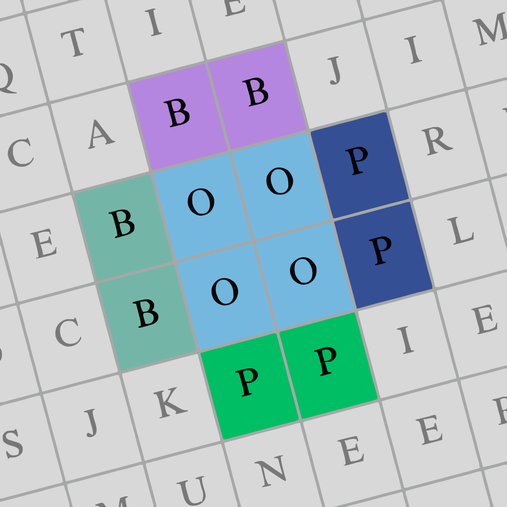
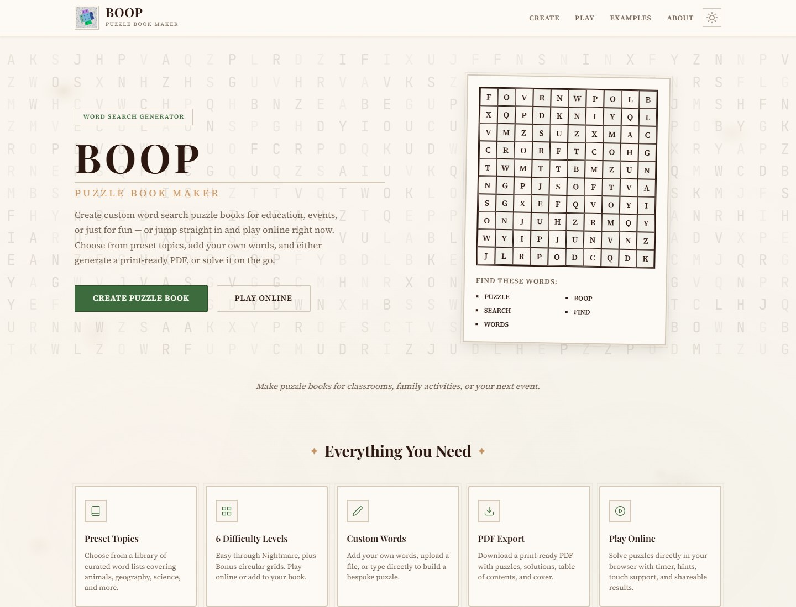
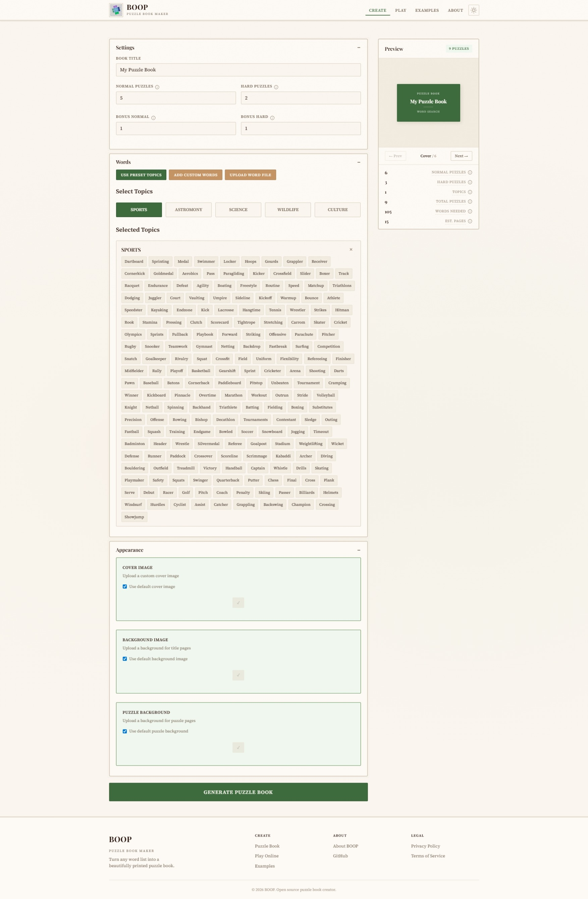
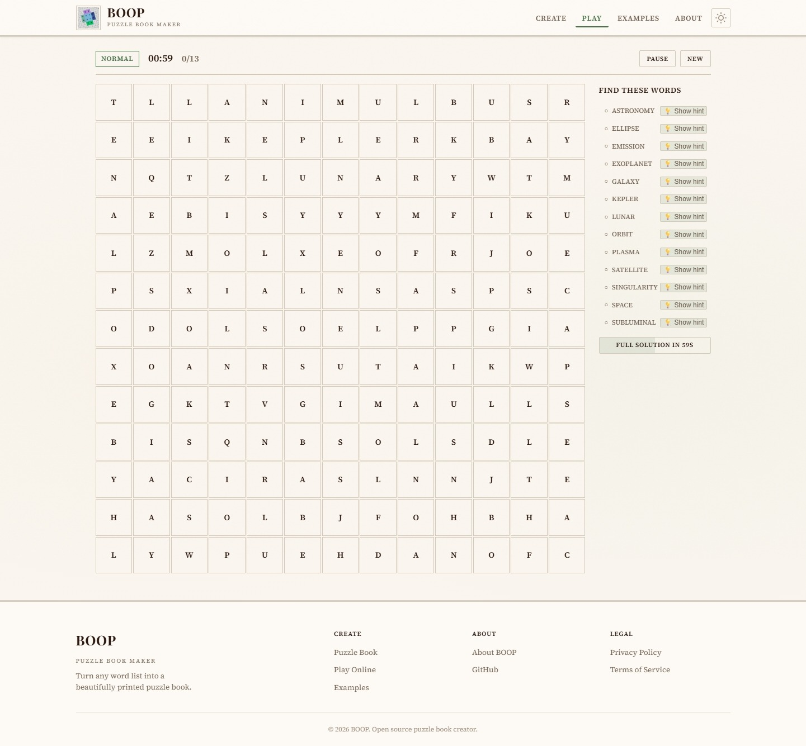
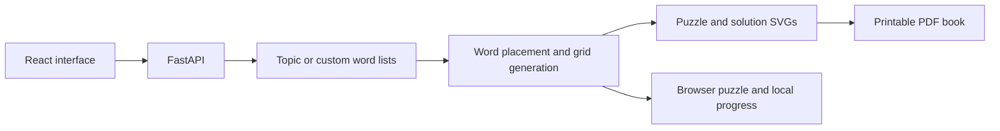

<div align="center">



# BOOP Web

**Make a word-search book worth printing—or play the next puzzle now.**

Choose a theme, bring your own words and artwork, and leave with a PDF containing puzzles and solutions.

[](https://github.com/Muneer320/BOOP-web/actions/workflows/deploy.yml) [](LICENSE)

[**Open the app**](https://boop-web.vercel.app/) · [**Sample books**](https://boop-web.vercel.app/examples) · [**Run locally**](#run-it-locally)

</div>

## Your words, a printable puzzle book

BOOP began as [a Python CLI](https://github.com/Muneer320/BOOP) for turning topic-organized words into PDFs. The web version makes that workflow visual: choose built-in topics or custom words, set puzzle counts, customize the cover/backgrounds, and download the assembled book. For a shorter session, generate a puzzle and solve it directly in the browser.



| Create for a theme | Make it a book | Play immediately |
| --- | --- | --- |
| Built-in topics, typed words or a `.txt` list | Cover, contents, topic pages, puzzle grids and solutions | Difficulty modes, hints, timer, saved progress and solved-grid export |

<details>
<summary><strong>See book creation, browser play and the full feature list</strong></summary>

**Puzzle books (PDF)**
- Topics from the built-in word lists, your own typed words, or an uploaded `.txt` word list.
- Normal (13×13) and Hard (17×17) puzzles, plus circular "bonus" puzzles for each.
- Cover page, table of contents, a title page per section, and a solutions section.
- Optional custom cover, page background and puzzle background images.
- Progress is shown while the book is generated. If some words cannot be fitted into a grid, the API says which puzzle failed instead of returning a book with a missing page.

**Play in the browser**
- Six modes, from Easy (10×10, forwards only) to Nightmare (20×20), plus a circular Bonus grid.
- Drag or tap to select words, with hints, a timer and progress that survive a page refresh.
- When you finish, download a poster of the solved grid or share it.

**Interface**
- Light and dark themes, responsive layout, keyboard navigation.

| Create a book | Play |
|---|---|
|  |  |

</details>

## From word list to pages—or a playable grid



Generation uses a temporary directory per request so separate books do not mix files. Unfittable words/puzzles produce an explicit failure rather than a book silently missing pages. The generator reports progress to the interface while assembling the PDF.

## Run it locally

Use Git, Python 3.12+ (matching backend CI) and Node.js; Node 24 is verified for the frontend checks/build. No account or API key is needed for local generation/play.

```sh
git clone https://github.com/Muneer320/BOOP-web.git
cd BOOP-web
```

In the first terminal, create/activate a Python virtual environment for your shell, then:

```sh
cd Backend
python -m pip install -r requirements.txt
python -m uvicorn app:app --reload --host 127.0.0.1 --port 8000
```

In a second terminal, starting from the repository root:

```sh
cd frontend
npm ci
npm start
```

Open [localhost:3000](http://localhost:3000). The frontend's `REACT_APP_API_URL` defaults to `http://localhost:8000/api`. Backend `CORS_ORIGINS` defaults to `http://localhost:3000`. To try a book, choose one topic, reduce counts for a small first run and download the result; **Play** starts a browser grid instead.

<details>
<summary><strong>Stack, source layout and deployment</strong></summary>

| Part | Stack | Hosted on |
|---|---|---|
| Frontend (`frontend/`) | React 19, React Router 7, Create React App | Vercel |
| Backend (`Backend/`) | FastAPI, svgwrite, svglib + ReportLab, pypdf, slowapi | Hugging Face Spaces (Docker) |

The generator places the words on a grid, draws each puzzle and its solution as SVG, and converts the pages into one PDF. Books are built in a temporary directory per request, so several books can be generated at the same time.

```text
Backend/
  app.py              FastAPI app, CORS and rate limiting
  routers/            generate, play, files, words, settings, templates, status
  boop/               puzzle generator and PDF assembly (from the original CLI)
  tests/              pytest suite
frontend/
  src/components/     pages and UI components
  src/context/        generation progress and theme state
  public/examples/    sample books shown on the Examples page
scripts/              helper for regenerating the Wordo sample book
```

Every push to `master` runs backend tests before syncing `Backend/` to Hugging Face Spaces through the [existing workflow](.github/workflows/deploy.yml). Vercel builds the frontend from that branch. Deployments depend on their configured account secrets/settings; a frontend URL alone does not prove the backend is healthy.

</details>

<details>
<summary><strong>HTTP routes and upload/progress behavior</strong></summary>

| Method | Path | Purpose |
|---|---|---|
| GET | `/api/status` | Health check |
| GET | `/api/settings` | Grid sizes and word limits used by the generator |
| GET | `/api/topics`, `/api/topics/{topic}/words` | Built-in word lists |
| GET | `/api/templates`, `/api/templates/{id}` | Bundled cover and background images |
| POST | `/api/upload` | Upload an image or a word list. Returns a random file id |
| GET / DELETE | `/api/files/{file_id}` | Fetch or delete one uploaded file by its id |
| POST | `/api/generate-puzzle?session_id=…` | Build a book and return the PDF |
| GET | `/api/generation-progress/{session_id}` | Progress of a book that is being generated |
| POST | `/api/play/generate` | One puzzle for the in-browser game |

Request and response examples are in [Backend/README.md](Backend/README.md).

Uploaded resources use random IDs, not authenticated user accounts. Avoid private materials in a shared/public deployment and treat a file identifier as access to that resource. Browser game progress is local to the browser; no shared account history is implied.

</details>

## Verify and contribute

From `Backend`, install `pytest httpx` and run `python -m pytest`. From `frontend`, run `npm test -- --watch=false --runInBand` and `npm run build`. Legacy Create React App build-tool advisories remain a separate known limitation; do not treat a successful build as a clean dependency audit.

For a focused PR, run affected checks and generate/play a small puzzle before updating the related setup/API documentation. Report a reproducible issue with synthetic words/images in [the tracker](https://github.com/Muneer320/BOOP-web/issues).

<details>
<summary><strong>From the original CLI to the web redesign</strong></summary>

The first web version (April–May 2025) was a small React form around the CLI generator. It is kept as the [`v2.0-before-finishupathon`](https://github.com/Muneer320/BOOP-web/tree/v2.0-before-finishupathon) tag.

In June 2026 I rebuilt most of the app during the Finish-Up-A-Thon hackathon. The work included the redesign, dark mode, the in-browser game, live generation progress, the Examples page and security fixes. Later cleanups made book generation safe to run concurrently, made generation failures report a clear error, shrank the generated PDFs (the Wordo sample went from 26.8 MB to under 0.5 MB) and added tests.

</details>

[Backend setup and API examples](Backend/README.md) · [Frontend source](frontend/src/) · [MIT license](LICENSE)
